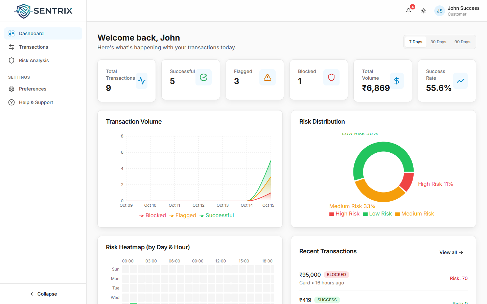
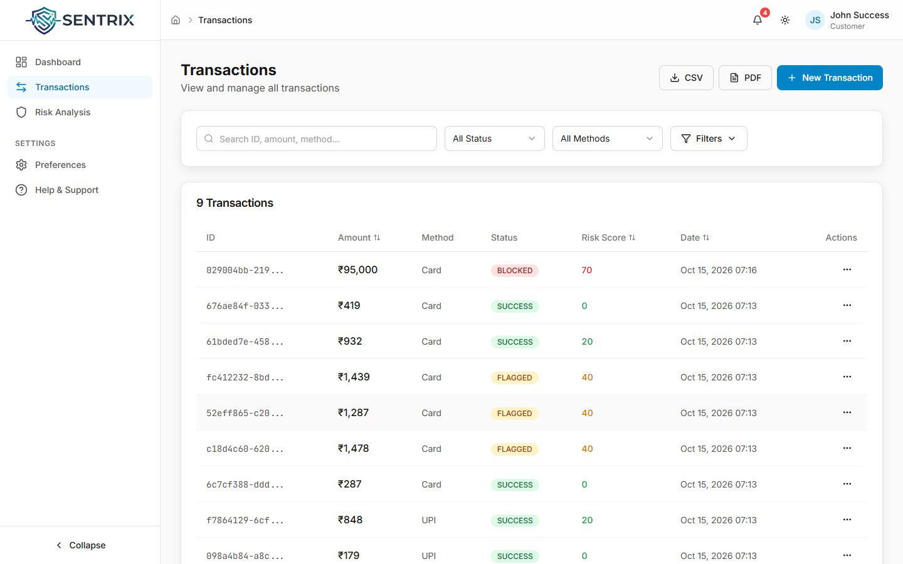
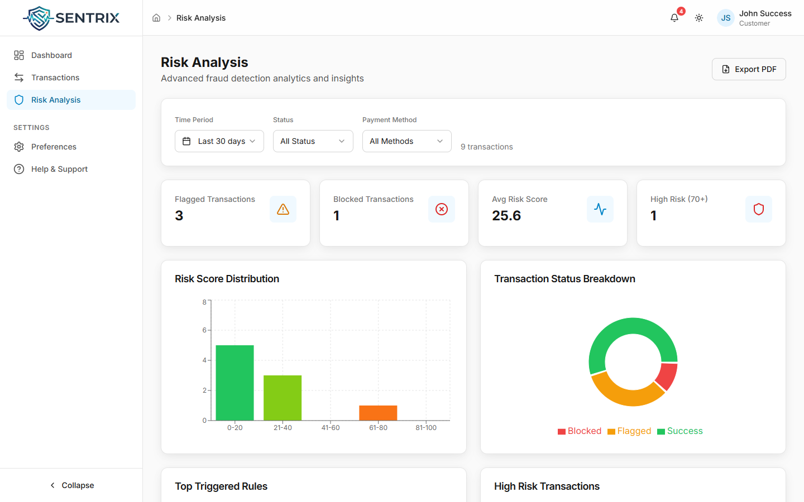
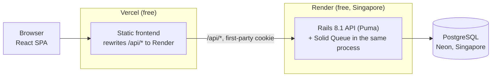
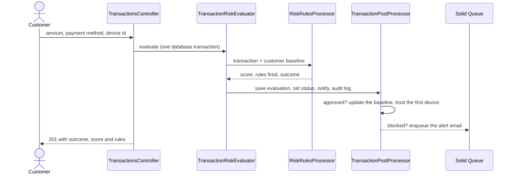

<p align="center">
  <picture>
    <source media="(prefers-color-scheme: dark)" srcset="docs/images/logo-dark.png">
    
  </picture>
</p>

<h1 align="center">Fintech Fraud Detection</h1>

<p align="center">
  Real-time, explainable risk scoring for payments.<br>
  Every transaction is scored by rules as it arrives and comes back <b>approved</b>, <b>flagged</b> or <b>blocked</b>, with the reasons listed.
</p>

<p align="center">
  <a href="https://fintech-fraud-detection-aryan.vercel.app"><strong>Live demo</strong></a>
  &middot;
  <a href="#try-it-live">Demo login</a>
  &middot;
  <a href="#how-it-works">How it works</a>
  &middot;
  <a href="#run-it-locally">Run locally</a>
  &middot;
  <a href="backend/public/openapi.yaml">API reference</a>
</p>

<p align="center">
  <a href="https://github.com/A-RYAN-1/fintech-fraud-detection/actions/workflows/ci.yml"></a>
  
  
  
  
  
  
  
</p>

<p align="center">
  <a href="https://fintech-fraud-detection-aryan.vercel.app">
    <picture>
      <source media="(prefers-color-scheme: dark)" srcset="docs/images/dashboard-dark.png">
      
    </picture>
  </a>
</p>

<p align="center"><sub>Last updated: 2026-10-15 &middot; Live on free tiers (Vercel, Render, Neon)</sub></p>

---

## Contents

- [About](#about)
- [Try it live](#try-it-live)
- [Features](#features)
- [Why it exists](#why-it-exists)
- [How it works](#how-it-works)
- [Engineering quality](#engineering-quality)
- [Run it locally](#run-it-locally)
- [Environment variables](#environment-variables)
- [Deployment](#deployment)
- [Status and roadmap](#status-and-roadmap)
- [Credits](#credits)

## About

A payment app has to decide in the moment whether a transaction looks like its owner. This project
does that with a small rules engine: each new transaction is compared with the customer's own history
(their average amount, how many payments they made in the last minute, the device they normally use)
and every rule that fires adds points to a risk score. At 30 points the transaction is **flagged**, at
70 it is **blocked**, and the response says exactly which rules fired, so a support agent or the
customer can see why.

Behind it sit the parts a real system needs around a decision: a per-customer baseline that only
learns from approved payments, notifications and an email on every block, an audit log of every
decision, customer feedback on each verdict, and an analytics dashboard.

## Try it live

Open **https://fintech-fraud-detection-aryan.vercel.app** and sign in:

| Role | Email | Password |
|---|---|---|
| Customer | `john@example.com` | `password123` |
| Reviewer (approves held payments up to $5,000) | `judge.reviewer@sentrix.demo` | `password123` |

These are public sandbox accounts (PayPal sandbox, no real money); the sign-in page lists them too. The API runs on a free instance that sleeps after 15
minutes without traffic, so the first sign-in can take about a minute.

Things to try in the first two minutes:

1. Open the **dashboard**: payment counts by outcome, volume over time, risk distribution and a risk
   heatmap by day and hour.
2. Create a small card payment. Your browser is a device this account has never used, so it comes
   back **flagged** with `UNTRUSTED_DEVICE`.
3. Create a 95,000 card payment. It comes back **blocked**, with the rules that fired listed (for
   example `AMOUNT_DEVIATION_HIGH` and `UNTRUSTED_DEVICE`).
4. Open **Risk Analysis** to see score ranges, the most-triggered rules and the high-risk payments.
5. Open the bell: each flagged or blocked payment raised a notification.

<table>
  <tr>
    <td width="50%"><p align="center"><sub>Every payment with its outcome and risk score</sub></p></td>
    <td width="50%"><p align="center"><sub>Risk analysis by period, status and method</sub></p></td>
  </tr>
</table>

## Features

- **Rule-based risk scoring** on every new transaction, synchronous: the API answers with the
  outcome, the score and the rules that fired (see [the rules](#the-rules)).
- **Explainable second score**: a small logistic regression runs next to the rules, returns a risk
  estimate and the three strongest reasons, and can raise a flag but never blocks (see
  [the second score](#the-second-score)).
- **Per-customer baseline**: transaction count, total and average amount, updated only from approved
  payments, so a fraudster's blocked attempts never move the average. The first device used for an
  approved payment becomes the trusted device.
- **Device tracking**: payments from another device, or with no device id, add risk.
- **Customer feedback** on each verdict (accurate or not, with a comment), once per transaction,
  recorded in the audit log.
- **Notifications** for every flagged or blocked payment (list, mark read, mark all read, delete) and
  an **email** on every block, sent in the background by Solid Queue.
- **Audit log** of every decision and every piece of feedback, and of every role or status change an admin makes.
- **Admin API** (`/api/v1/admin`): admins and managers list users with filters and pagination; admins suspend or reactivate an account and change a role, each change written to the audit log, and read the audit log itself. Admins also tune the risk rules (thresholds, points, multipliers) with an audited change and a reset to defaults; managers can read them. A suspended user's open session ends on its next request.
- **Weekly report** job (`WeeklyReportJob`) that emails each customer a summary of their last 7 days.
- **Analytics API and dashboard**: totals by outcome, volume over 7, 30 or 90 days, risk distribution,
  a day-by-hour heatmap, score ranges, top triggered rules and high-risk payments, filterable by
  period, status and payment method.
- **Transactions view** with search, filters, sorting and CSV or PDF export.
- **Accounts**: sign-up, sign-in and sign-out with a server-side session cookie; light and dark themes.

## Why it exists

A learning project: the two of us built it to learn rule-based risk scoring and background jobs in
Rails 8 on a realistic fintech problem. It taught how to keep scoring explainable (each blocked or
flagged payment lists the rules that fired), how to keep a decision and its side effects consistent,
and how much a small app has to handle once sessions, devices and audit logs are real.

## How it works



What happens when a payment is created (`POST /api/v1/transactions`):



The rules, the evaluation record, the status change, the notification and the audit entry all run
inside one database transaction: if any step fails, none of them is saved. Only the email leaves the
transaction, as a background job.

### The rules

| Rule | Fires when | Points |
|---|---|---|
| `FIRST_TRANSACTION_HIGH_AMOUNT` | the customer's first payment is over 100,000 | 30 |
| `AMOUNT_DEVIATION_HIGH` / `_MEDIUM` / `_LOW` | the amount is at least 10x / 5x / 2x the customer's average | 40 / 30 / 20 |
| `RAPID_MEDIUM_AMOUNT` | 1,000 to 9,999, with 4 or more payments in the last minute | 20 |
| `RAPID_LARGE_AMOUNT` | 10,000 to 49,999, with 3 or more in the last minute | 30 |
| `RAPID_VERY_LARGE_AMOUNT` | 50,000 or more, with 2 or more in the last minute | 40 |
| `UNTRUSTED_DEVICE` | the device differs from the customer's trusted device | 30 |
| `MISSING_DEVICE_ID` | no device id was sent | 50 |

Outcome: under 30 approved, 30 to 69 **flagged**, 70 or more **blocked**. These numbers are the shipped
defaults. Nineteen of them (thresholds, points, multipliers, amount bounds, the velocity window) live in the
`risk_rule_settings` table and an admin can change them through the API without a deploy; see
[`RiskRuleConfig`](backend/app/models/risk_rule_config.rb) for each key, its default and its allowed range.

### The second score

The rules are fixed constants, so they cannot see the hour, the payment method, a new IP address or
a burst over the last hour. A logistic regression adds those signals as a second opinion:

- **What it returns**: `ml_score` (a probability) and `ml_explanation` (the top three features that
  pushed it up, each with its contribution) on every transaction. The contributions are exact for a
  linear model: coefficient times the feature's distance from the training average.
- **What it can do**: lift an approved payment to flagged, with the rule `ML_RISK_SCORE`. It never
  blocks, never lowers a rule result, and if it fails the rules decide alone. `ML_SCORE_ENABLED=false`
  turns it off.
- **How it is served**: a versioned file of coefficients ([`risk_model_v1.json`](backend/config/ml/risk_model_v1.json))
  evaluated in plain Ruby ([`ml_risk_scorer.rb`](backend/app/services/ml_risk_scorer.rb)). No extra gem, no
  extra service, no cost, no cold start.
- **How it was built**: [`ml/`](ml/) holds the synthetic data generator, the training script and the
  results. Training ran on Kaggle, not on a laptop. A golden test replays vectors from the training run in Ruby, so
  the two implementations cannot drift apart unnoticed.

**Measured on 40,000 held-out synthetic transactions (3.4% fraud), 2026-10-21**

| | Precision | Recall | False positive rate | PR-AUC |
|---|---|---|---|---|
| Rules alone (flagged or blocked) | 5.5% | 18.3% | 11.0% | 0.045 |
| Rules or logistic regression (shipped) | 7.7% | 31.4% | 13.1% | 0.112 (model alone) |
| Rules or gradient boosting | 7.8% | 31.7% | 13.0% | 0.127 (model alone) |
| Rules or isolation forest | 6.0% | 23.8% | 13.0% | 0.071 (model alone) |

The cut-off was chosen on a separate validation set so the second score adds at most two points of
false positives. Gradient boosting is 0.3 points better on recall, not enough to give up exact
explanations and a dependency-free scorer, so logistic regression ships. Full numbers:
[`ml/results/metrics.json`](ml/results/metrics.json) and [`docs/ml-second-score.md`](docs/ml-second-score.md).

**Limit, stated plainly:** there is no real labelled fraud data. The labels come from a generator I
wrote ([`ml/synthetic.py`](ml/synthetic.py)), so these numbers show the second score adds signal the
rules lack on that generator, not that it detects real fraud. The customer feedback (accurate or not)
already stored on each evaluation is the route to real labels.

### Tech stack

| Layer | Technology |
|---|---|
| Backend | Ruby on Rails 8.1 (API mode), Ruby 3.2, Puma, Solid Queue (database-backed jobs, no Redis), Action Mailer |
| Database | PostgreSQL: 16 locally in Docker, Neon (free) in production |
| Frontend | React 19, TypeScript, Vite 7, Tailwind CSS 3, Redux Toolkit, TanStack Query, Axios |
| Tests and checks | Minitest, Vitest, Brakeman, bundler-audit, RuboCop, ESLint, Prettier |
| Hosting | Vercel (frontend), Render free web service (API, Docker), Neon free (PostgreSQL) |
| Local setup | Docker Compose for the API and PostgreSQL; mise pins Node for the frontend |

### Design decisions

1. **Additive, explainable rules instead of a model.** Every decision is a sum of named rules, so the
   response, the audit log and the dashboard can all say why. Trade-off: fixed thresholds that do not
   adapt beyond the customer's averages.
2. **Score synchronously, in one database transaction.** The customer gets the verdict in the same
   response, and a decision is never half-saved. Trade-off: every rule adds latency to the payment
   request; slow work (email) is pushed to a job.
3. **The baseline learns only from approved payments.** Blocked or flagged attempts never raise the
   average that later payments are compared with. Trade-off: a new customer has no average, so only
   the first-payment and device rules protect their first payments.
4. **Solid Queue inside Puma.** Jobs live in PostgreSQL and run in the web process, so one free
   instance runs everything without Redis. Trade-off: jobs share the instance's 512 MB and CPU with
   web requests.
5. **The frontend proxies `/api` to the API.** Vercel rewrites `/api/*` to Render, so the session
   cookie is first-party and works in browsers that block third-party cookies. Trade-off: one extra
   hop per request.

<details>
<summary><strong>Project structure</strong></summary>

```
compose.yaml                     local API + PostgreSQL
render.yaml                      Render blueprint for the API
backend/                         Rails API
  app/controllers/api/v1/        auth, transactions, feedback, notifications, analytics, health, admin
  app/services/                  risk_rules_processor, transaction_risk_evaluator,
                                 transaction_post_processor
  app/models/                    user, transaction, device, fraud_evaluation,
                                 user_transaction_stat, notification, audit_log
  app/jobs/, app/mailers/        weekly report job, blocked-payment and weekly emails
  config/recurring.yml           Solid Queue schedule
  test/                          models, services, integration, mailers
  postman/, public/openapi.yaml  API documentation
frontend/                        React + TypeScript (Vite)
  src/pages/                     dashboard, transactions, risk analysis, settings, help
  src/features/                  auth, dashboard, transactions, notifications
  src/store/, src/hooks/         Redux Toolkit store, TanStack Query hooks
```

API documentation: the [OpenAPI specification](backend/public/openapi.yaml) and the
[Postman collection](backend/postman/MASTER_COLLECTION.json).

</details>

## Engineering quality

| Area | What is in place |
|---|---|
| Tests | Backend: 92 Minitest runs (298 assertions, 2026-10-22) over models, the risk evaluator, integration tests of auth, transactions, notifications, analytics, the admin API and the editable rules, and mailers. Frontend: 174 Vitest tests in 23 files (UI components, hooks, Redux slices, form schemas, utils), all passing on 2026-10-15 |
| Security | Session in an httpOnly, Secure, SameSite=None cookie; CORS and Rails host authorization limited to the frontend origin; `SECRET_KEY_BASE` from the environment, never committed; secrets only in `.example` files |
| Consistency | Each decision and its side effects are written in one database transaction |
| CI | GitHub Actions on every push and pull request: Minitest against PostgreSQL 16, Vitest, the TypeScript check and the production build (`.github/workflows/ci.yml`); CodeQL for Ruby, TypeScript and the workflows; Dependabot version updates, grouped weekly |
| Checks available, not in CI yet | Brakeman, bundler-audit and RuboCop (backend); ESLint and Prettier (frontend). They report existing findings, fixed in the next iteration before they become required |
| Measured | Production image under a 512 MB limit: about 210 MB in use, healthy in 9 s (2026-10-14) |

Run them:

```bash
docker compose exec api bin/rails test          # backend tests (API container running)
docker compose exec api bundle exec brakeman    # security scan
cd frontend && npm test                         # frontend tests
cd frontend && npm run lint                     # ESLint
```

## Run it locally

Works on Windows (Git Bash), macOS and Linux. You need **Docker** (Docker Desktop on Windows and
macOS, started first) and **Node 24**. Ruby and PostgreSQL are not installed on the host: they run in
containers.

### 1. API and database (Docker Compose)

From the repository root:

```bash
docker compose up
```

The first run installs the gems, creates, migrates and seeds the database, and takes a few minutes.
It is ready when this returns `"status":"ok"`:

```bash
curl http://localhost:3000/api/v1/health
```

The API is at `http://localhost:3000/api/v1`. Stop it with `docker compose down` (add `-v` to also
drop the database and the gem cache).

### 2. Frontend (Vite)

Node is pinned in `frontend/mise.toml`. With [mise](https://mise.jdx.dev) installed, it picks Node 24
for you; otherwise use any Node 24.

```bash
cd frontend
cp .env.example .env      # points the app at the local API
mise install              # skip if you manage Node another way
npm ci
npm run dev
```

Open `http://localhost:5173` and sign in with a seeded demo user: `john@example.com` /
`password123`. Then try the payments from [Try it live](#try-it-live).

<details>
<summary><strong>Without Docker</strong></summary>

Install Ruby 3.2 and PostgreSQL yourself, copy `backend/.env.development.example` to `backend/.env`
and fill in your database user, then from `backend/`: `bundle install`, `bin/rails db:prepare`,
`bin/rails server`.

</details>

## Environment variables

Local runs need nothing beyond the defaults above: `compose.yaml` sets the backend variables and
`frontend/.env.example` the frontend ones.

**Frontend** (`frontend/.env`)

| Variable | What it is | Local value |
|---|---|---|
| `VITE_API_BASE_URL` | Base URL of the backend API (`/api/v1` on Vercel) | `http://localhost:3000/api/v1` |
| `VITE_APP_NAME` | Name shown in the UI | `Fintech Risk Engine` |

**Backend** (see `backend/.env.development.example` and `backend/.env.production.example`)

| Variable | What it is | Needed |
|---|---|---|
| `DATABASE_HOST`, `DATABASE_PORT`, `DATABASE_USER`, `DATABASE_PASSWORD`, `DATABASE_NAME` | PostgreSQL connection for development | local |
| `DATABASE_URL` | PostgreSQL connection string | production |
| `SECRET_KEY_BASE` | Signs the session cookie (`bin/rails secret`) | production |
| `FRONTEND_URL` | Frontend origin: allowed by CORS and by host authorization (it proxies `/api`) | always |
| `APP_HOST` | The API's own host: host authorization and links in emails | always |
| `ML_SCORE_ENABLED` | `false` switches the second score off; default on | optional |
| `SOLID_QUEUE_IN_PUMA` | `true` runs background jobs inside the web process | optional |
| `SMTP_ADDRESS`, `SMTP_PORT`, `SMTP_USERNAME`, `SMTP_PASSWORD` | Mail server for the emails; without `SMTP_USERNAME` mail is skipped | optional |
| `RAILS_LOG_LEVEL` | Log level | optional |

Never commit a real `.env` file; only the `.example` files are tracked.

## Deployment

Free tiers only: the API on a Render free web service (Docker), PostgreSQL on Neon, the frontend on
Vercel. Pushes to `main` deploy the frontend automatically; Render rebuilds the API when `backend/`
changes.

<details>
<summary><strong>Backend on Render</strong></summary>

1. Neon: create a project, open *Connect*, turn connection pooling off and copy the direct connection
   string (migrations take advisory locks, which a pooler breaks).
2. Render: *New > Blueprint*, pick this repository. `render.yaml` creates the free web service from
   `backend/Dockerfile`, generates `SECRET_KEY_BASE`, and asks for `DATABASE_URL`, `FRONTEND_URL` and
   `APP_HOST`.
3. The container runs `bin/rails db:prepare` on every start, then Puma on `$PORT` with Solid Queue
   inside it. Health check: `/up`.
4. Demo data: on an empty database `db:prepare` loads the schema and runs `db/seeds.rb` once (5 users,
   32 transactions); later restarts only migrate.

</details>

<details>
<summary><strong>Frontend on Vercel</strong></summary>

1. Import the repository with root directory `frontend` (framework preset: Vite).
2. Set `VITE_API_BASE_URL=/api/v1`. If the Render service URL differs from the one in
   `frontend/vercel.json`, update the rewrite destination.
3. Put the Vercel URL in the API's `FRONTEND_URL`.

</details>

## Status and roadmap

**Reached:** runs locally from a fresh clone on Windows and Linux (checked 2026-10-13) and is live on
free tiers since 2026-10-15. Checked live that day: sign-in, session cookie, transaction list, and a
95,000 payment from a new device blocked.

**Known limitations**

- The free API instance sleeps after 15 minutes idle; the first request after that takes about a
  minute.
- The live demo sends no email (no mail server is configured), so block alerts and weekly reports
  appear only as in-app notifications and audit entries.
- The admin pages are in the frontend code but not linked from the navigation yet; the admin API behind them is live. There is no screen for the editable risk rules yet, only the API.
- CI runs the tests and the build only; lint, Brakeman and bundler-audit join once their existing findings are fixed.
- Ruby 3.2 is past end of life, and `bundler-audit` reports advisories in the locked gems.

**Planned**

- [x] CI (GitHub Actions) running both test suites and the build on every push, CodeQL and Dependabot
- [ ] Lint and the security checks (Brakeman, bundler-audit, `npm audit`) required in CI
- [ ] An uptime check on the live URL and Lighthouse numbers for the frontend
- [ ] Ruby and gem upgrades until Brakeman and bundler-audit are clean
- [ ] Period-over-period change on the dashboard cards, computed by the analytics API
- [x] Explainable second risk score next to the rules (2026-10-21)
- [x] Admin API for the users and audit-log pages (2026-10-22)
- [x] Risk rules editable by an admin, audited, with defaults and limits (2026-10-22)
- [ ] Confirm the weekly report schedule (`config/recurring.yml`) runs in production

## Credits

Built by two people:

- **Aryan Deshmukh** ([A-RYAN-1](https://github.com/A-RYAN-1)): the backend (Rails API, risk rules
  engine, PostgreSQL, Solid Queue jobs) and this free deployment.
- **Tanmay Tambat** ([OldStager01](https://github.com/OldStager01)): the frontend and the original deployment. The
  original repository is
  [OldStager01/fintech-fraud-detection](https://github.com/OldStager01/fintech-fraud-detection).
